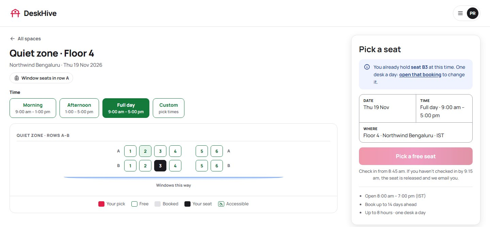
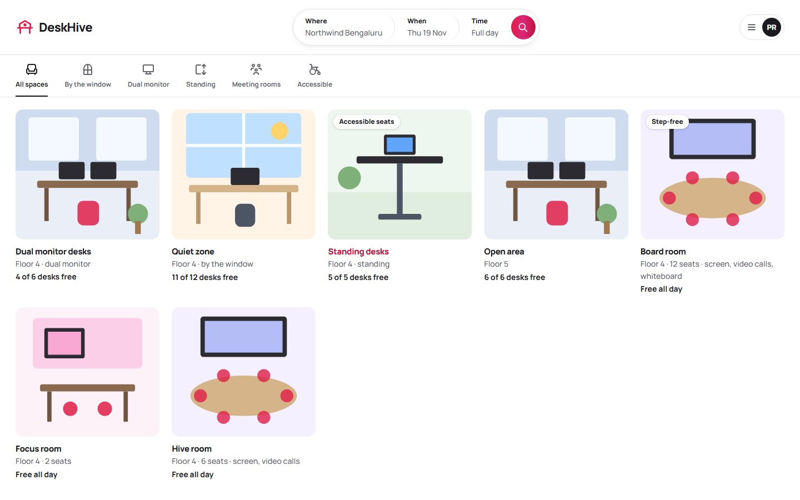
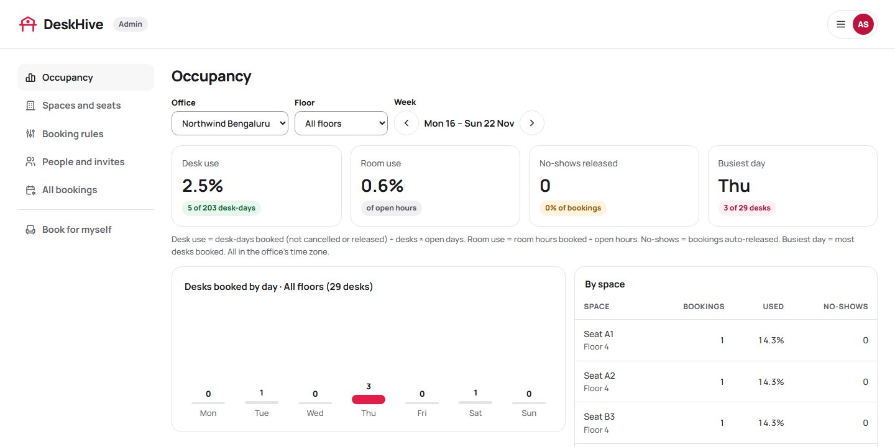

# DeskHive

[](https://github.com/Pavithiran21/DeskHive/actions/workflows/ci.yml)

**Live demo: [deskhive-pavithiran.onrender.com/demo](https://deskhive-pavithiran.onrender.com/demo)** (log in as an Employee or an Admin in one click). It runs on free hosting, so the first load after a quiet spell can take a minute or two.

Desk and meeting-room booking for hybrid offices. Employees see what is free on the days they come in, then book, change, check in to and cancel desks and rooms. Admins set up offices, floors and spaces, set the booking rules, invite people and see how the space is used. Bookings nobody turns up for release themselves.

**Java 21 · Spring Boot 4 · MySQL 8.4 · Flyway · React 19 · TanStack Query · Tailwind CSS 4 · Playwright**



**What's hard here**

- **No double booking under concurrent requests.** MySQL has no exclusion constraint for overlapping times, so the booking takes row locks on the user and the space (always in the same order, so no deadlocks) and only then checks for overlap, under READ COMMITTED. Twenty people clicking at once get one booking and nineteen 409s ([BookingService.java](backend/src/main/java/com/deskhive/booking/BookingService.java)).
- **Jobs that act exactly once.** Auto-release is a conditional `UPDATE … WHERE status = 'CONFIRMED'`, and only the run that changes the row sends the email. A check-in at the same moment takes the row lock, so a booking is either checked in or released, never both ([ReleaseService.java](backend/src/main/java/com/deskhive/job/ReleaseService.java)).
- **Bookings in your calendar.** Every confirmation carries an iCalendar file. A change sends the same `UID` with a higher `SEQUENCE`, so the event moves instead of duplicating, and a cancellation or auto-release removes it ([BookingCalendar.java](backend/src/main/java/com/deskhive/mail/BookingCalendar.java)).

| Find a space | Occupancy (Admin) |
|---|---|
|  |  |

## Signature feature: no double booking, even under concurrent requests

When many people click "Book" on the same desk at the same moment, exactly one booking is confirmed. MySQL has no exclusion constraint for overlapping time ranges, so `BookingService` (`backend/src/main/java/com/deskhive/booking/BookingService.java`) does this in one transaction:

1. `SELECT … FOR UPDATE` on the **user** row, so one person's parallel requests run one after the other and "one desk per day" can't be passed twice at once.
2. `SELECT … FOR UPDATE` on the **space** row, so every request for that desk or room queues here. Other spaces are not locked.
3. Only then the **overlap check and the INSERT**. A request that waited on the lock runs its check after the winner commits, sees the winner's booking and gets **409 Conflict**.

Two details make it correct. Locks are always taken in the same order (user, then spaces by ascending id, then the booking row), so two requests can never deadlock. The transaction uses **READ COMMITTED**, because under MySQL's default REPEATABLE READ the overlap check could read an old snapshot and miss a booking committed a moment earlier.

The same care goes into the jobs:
- **Auto-release.** A booking not checked in within 15 minutes of its start is released by `UPDATE … WHERE id = ? AND status = 'CONFIRMED'`. Only the run that changes the row sends the email. A check-in at the same moment takes the row lock, so a booking is either checked in or released, never both (`job/ReleaseService.java`).
- **Reminders** go out 1 hour before a booking starts. Opening hours, reminders and release all use the **office's own time zone**.

## Features

- Join by Admin invitation (single-use, 7-day link), log in, profile, password reset by email, delete my account (past bookings are kept but anonymised)
- Offices with a time zone, floors, desks (area, row, features) and rooms (capacity, equipment, accessibility)
- Availability search by date, time and type; book, change, cancel; "my bookings" by status
- Booking rules per office: opening hours (08:00–19:00), up to 14 days ahead, at most 8 hours, one desk a day
- Check in from 15 minutes before the start
- Emails: invitation, booking confirmation, reminder, auto-release notice, cancellation by an Admin, password reset
- **Calendar files (.ics)** on booking emails: the confirmation adds the booking to Google Calendar, Outlook or Apple Calendar, a change moves the same event, and an Admin cancellation or auto-release removes it. Times are in UTC, so every calendar shows them in the reader's own zone
- Occupancy and utilisation report
- Paginated lists and one JSON error format across the API

## Roles

| Role | Can | Cannot |
|------|-----|--------|
| Employee | Search, book, change, cancel and check in to their own bookings | Open admin screens or endpoints (403), or touch another person's booking (404) |
| Admin | Everything an Employee can, plus manage offices, spaces and rules, invite and remove Employees, cancel any booking (the employee is emailed), view occupancy | Remove another Admin (403); Admins are managed only by the seed command |

The first Admin is created by a seed command. Everyone else joins by invitation, and there is no public sign-up.

## Tech stack

| Layer | Choice |
|-------|--------|
| Backend | Java 21, Spring Boot 4.1.2 (Web MVC, Security, Data JPA, Validation, Mail, Thymeleaf), Flyway, MySQL 8.4, JJWT, Bucket4j + Caffeine |
| Frontend | React 19, Vite 8, React Router 8, TanStack Query 5, React Hook Form + Zod, Tailwind CSS 4, Tabler icons |
| Email | Any SMTP server: Ethereal for development, Brevo for real mail |

## Project structure

```
backend/src/main/java/com/deskhive/
  booking/        BookingService (locks + overlap check), BookingRules, admin and employee controllers
  availability/   free spaces for a date and time
  office/         offices, floors, spaces
  invitation/ admin/   inviting and managing people
  job/            ScheduledJobs, ReleaseService, ReminderService, job runs
  report/         occupancy
  mail/           MailService, BookingCalendar (the .ics files)
  auth/ user/ demo/ common/ config/ (FrontendConfig serves the built app when STATIC_DIR is set)
  seed/           seed-dev / seed-demo / seed-admin / seed-test profiles, SampleData (the Northwind office)
backend/src/main/resources/  application.yml, db/migration/ (Flyway), templates/mail/
frontend/src/     api/ auth/ features/ components/ layout/ ...
e2e/              Playwright: tests/api and tests/ui, make-env.js, prepare.js
.github/workflows/  CI: build, lint, the Playwright suite against MySQL 8.4, and the Docker image
Dockerfile        one image: Spring Boot also serves the built frontend (one origin)
```

## Run locally

**You need** Java 21 (Temurin), MySQL 8.4 and Node 26. Create the database once:

```powershell
mysql -u root -p -e "CREATE DATABASE deskhive"
```

Create `backend/.env`. It is read as a properties file, so write values **without quotes**.

| Variable | What it is |
|----------|------------|
| `DB_HOST`, `DB_PORT`, `DB_NAME`, `DB_USER`, `DB_PASSWORD` | MySQL connection (`127.0.0.1`, `3306`, `deskhive`, `root`, …) |
| `APP_ENV` | `development` or `production` |
| `PORT` | API port (4000) |
| `FRONTEND_URL` | `http://localhost:5173`, used in email links |
| `COMPANY_NAME` | Company name shown in the app and emails |
| `JWT_SECRET` | Signs access tokens (at least 32 characters) |
| `JOB_TRIGGER_SECRET` | Secret for `POST /api/internal/jobs/release` and `/reminders` |
| `RATE_LIMITS_ENABLED` | `true` (log-in limit: 20 per 15 minutes per IP) |
| `LOG_LEVEL` | Root log level |
| `RELEASE_CRON`, `REMINDER_CRON` | Job schedules |
| `TIME_OVERRIDE_ENABLED` | `true` lets jobs and requests run "as of" another moment; development only |
| `DEMO_MODE` | `true` enables the `/demo` page |
| `DEMO_PASSWORD` | Password given to the seeded sample accounts |
| `SMTP_HOST`, `SMTP_PORT`, `SMTP_USER`, `SMTP_PASS`, `SMTP_FROM` | Outgoing mail |
| `DEMO_SMTP_HOST`, `DEMO_SMTP_PORT`, `DEMO_SMTP_USER`, `DEMO_SMTP_PASS` | Inbox for mail to `@demo.deskhive.test` addresses, so demo mail never goes to a real server |
| `STATIC_DIR` | Optional. A built `frontend/dist`; Spring then serves the app too (the Docker image sets it) |

Then:

```powershell
cd backend
.\mvnw.cmd -q -DskipTests package
# Seeds run once and exit. Flyway creates the tables on the first start.
java -jar target\deskhive-backend.jar --spring.profiles.active=seed-dev --spring.main.web-application-type=none

# Your own first Admin (the password comes from an environment variable):
$env:ADMIN_PASSWORD='choose-one-with-a-number1'
java -jar target\deskhive-backend.jar --spring.profiles.active=seed-admin --spring.main.web-application-type=none --email=you@company.test --name="Your Name"
Remove-Item Env:ADMIN_PASSWORD

java -jar target\deskhive-backend.jar       # API on http://localhost:4000

cd ..\frontend
npm ci
npm run dev                                  # app on http://localhost:5173 (Vite proxies /api)
```

The dev seed **empties** the `deskhive` database and builds the Northwind sample company: two offices in two time zones, floors, desks and rooms, two Admins, four Employees, invitations, and bookings in every status. It refuses to run on any other database.

**Or with Docker** (MySQL included, no `.env` needed):

```powershell
docker compose up --build
docker compose exec app java -jar /app/app.jar --spring.profiles.active=seed-demo --spring.main.web-application-type=none
# then open http://localhost:4000/demo
```

## Demo accounts

With `DEMO_MODE=true`, **http://localhost:5173/demo** offers **Log in as Employee / Admin**. The password is the one you set in `DEMO_PASSWORD`.

| Role | Email | What to try |
|------|-------|-------------|
| Employee | `employee@demo.deskhive.test` | Find a free desk for tomorrow, book it, change the time, check in to today's booking, cancel one. Blocked: opening the admin area is refused (403). |
| Admin | `admin@demo.deskhive.test` | Add a desk, change an office's booking rules, invite a new employee, cancel someone's booking (they get an email), read the occupancy report. Blocked: another Admin has no "Remove access". |

Demo accounts cannot change their email or password or delete themselves.

## Testing

**Playwright only**, in [`e2e/`](e2e): API tests with Playwright's `request` client and browser tests for both roles, against a real MySQL 8.4 (`deskhive_test`) and a real Ethereal inbox. CI runs them on every push.

- **16 tests**: 11 API and 5 browser.
- **Concurrency:** 20 people booking one desk and slot at once get one 201 and nineteen 409s (`SPACE_TAKEN`). One person sending five bookings for five desks at once still gets only one ("one desk a day"). A room can be booked back to back, but an overlap gets 409.
- **Rules and time zones:** opening hours, booking ahead and maximum length are each refused with their own reason. 09:00 in a London office is 09:00 UTC in November. Check-in opens 15 minutes before the start.
- **Jobs:** auto-release runs once, then twice more in parallel. The late booking is released exactly once, and a checked-in one stays.
- **Calendar files, read from the real email:** the confirmation's `.ics` has the booking's UID and UTC times. After a change, the same UID comes with a higher `SEQUENCE`, and an Admin cancellation or auto-release sends `METHOD:CANCEL`.
- **Access:** an Employee gets 403 on the admin API and 404 on another person's booking. In the browser, admin pages say "This page is for admins". The demo Admin reaches Spaces and seats.
- **Email:** password reset through the emailed link.

Requests pin "now" with `X-Test-Now` (refused in production), so the 14-day window and the check-in times are the same on any day. Every test creates its own office and claims its own Employees from a seeded pool of 4,000 (an atomic lock file per person), so tests run in parallel.

```powershell
cd e2e
npm ci
npx playwright install chromium
npm test        # writes .env.test, builds the jar, creates and seeds deskhive_test, starts the API and app, runs everything
```

## Deploy

The frontend runs on [Vercel](https://vercel.com) and the API on [Render](https://render.com), and the browser still sees one origin: [`frontend/vercel.json`](frontend/vercel.json) forwards `/api/*` to the Render service, so the cookies (SameSite=Strict) work with no CORS or cross-site cookies.

- **Frontend (Vercel):** import the repository, set the Root Directory to `frontend` (framework Vite, build `npm run build`, output `dist`). `vercel.json` also sends every other path to `index.html` for React Router and sets the page's security headers. If the Render service is renamed, change its URL in `vercel.json`.
- **API (Render):** one free web service from `Dockerfile.api` (see [`render.yaml`](render.yaml)). Flyway migrates on every start. The full `Dockerfile` (API plus built frontend on one origin) is what `docker-compose.yml` and CI use.

- **Database:** a free hosted MySQL-compatible database such as [TiDB Cloud](https://tidbcloud.com) Starter, with a `deskhive_demo` database. It requires TLS, so set `SPRING_DATASOURCE_URL` with `sslMode=VERIFY_IDENTITY` (see `render.yaml`). The row locks behind the booking guarantee are plain `SELECT … FOR UPDATE` statements (TiDB refuses the `FOR UPDATE OF <alias>` form that Hibernate's lock mode would send), and the whole Playwright suite, including the 20-people-one-desk test, passes on TiDB and on MySQL 8.4.
- **Settings:** `APP_ENV=production`, `SERVER_FORWARD_HEADERS_STRATEGY=native` and `SERVER_TOMCAT_REMOTEIP_INTERNAL_PROXIES=.*` (so rate limits see the visitor's IP behind Vercel and Render's proxies), `DEMO_MODE=true`, `FRONTEND_URL` = the Vercel URL, and SMTP plus `DEMO_SMTP_*`.
- **Demo data:** free Render has no Shell, so run the `seed-demo` profile once from your own machine, pointed at the same database.
- **Memory:** the image caps the JVM heap at half of the free plan's 512 MB, and the app stays near 360 MB under load.
- **Jobs:** free services sleep after 15 minutes without traffic, so an external cron (e.g. cron-job.org, every 5 minutes) calls `POST /api/internal/jobs/release` and `/reminders` with the `X-Job-Secret` header.
- **Email on free hosting:** Render's free plan blocks outbound SMTP, so the live demo sends no invitation, reminder or password-reset email, and an Admin's invitation link can't be used there; everything else works. Paid hosting or an email provider with an HTTPS API would lift this.

## Demo videos

- `DeskHive-full-workflow.webm`: an Admin invites an employee, the invitation link creates the account, a seat is booked and changed, two people race for one seat (one wins, the other gets the nearest free seat), check-in, an Admin cancellation, auto-release, and the occupancy report
- `DeskHive-employee-demo.webm`, `DeskHive-admin-demo.webm`: one walkthrough per role

<!-- To embed: edit this README on GitHub and drag the .webm files from the workspace videos/ folder here. -->

## License

Copyright (c) 2026 R.Pavithiran. All rights reserved. The source is public so you can read it and see how it is built. Please ask before copying, reusing or redistributing it.
